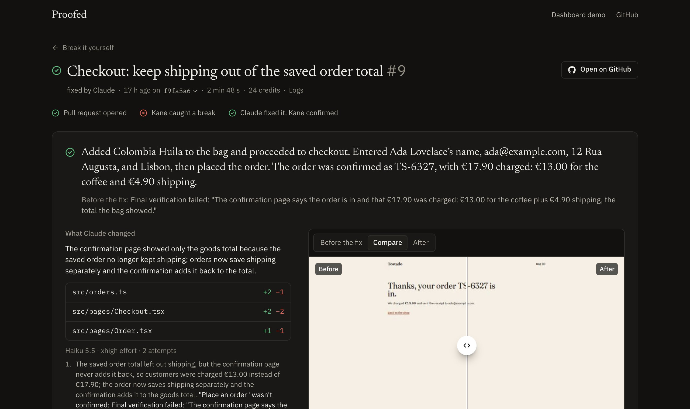

<div align="center">


# Proofed

**Every pull request, run in Chrome before you merge it.**

Kane CLI runs the user flows a pull request touches and posts the recording on the PR.<br>
When a flow breaks, Claude Code fixes it, and the fix is pushed only after Kane has watched it pass.

[**Break it yourself**](https://proofed.neptunescodm.workers.dev/try) · [Dashboard demo](https://proofed.neptunescodm.workers.dev/app?demo) · [Demo store](https://github.com/t1dem/proofed-demo-store) · [Install on GitHub](https://proofed.neptunescodm.workers.dev/install)

<sub>Built for the Kane CLI hackathon, November 2026.</sub>

<br>


</div>

<br>

<table>
<tr>
<th width="50%">✗ Kane catches the break</th>
<th width="50%">✓ Kane confirms Claude's fix</th>
</tr>
<tr>
<td></td>
<td></td>
</tr>
<tr>
<td>A €44.50 bag ships free, though free shipping starts at €50.</td>
<td>Claude changed one line in <code>src/pricing.ts</code>. Shipping is €4.90 again.</td>
</tr>
</table>

<p align="center"><sub>From <a href="https://github.com/t1dem/proofed-demo-store/pull/12">demo-store #12</a>: 8.5 minutes from opening the pull request to the fixed report.</sub></p>

## For judges

- **[Break it yourself](https://proofed.neptunescodm.workers.dev/try)**, no account. Pick one of four prepared pull requests and watch Kane catch the break and Claude fix it on the real [demo store](https://github.com/t1dem/proofed-demo-store). A run takes 8 to 14 minutes, one at a time, 3 per visitor a day.
- **[Dashboard demo](https://proofed.neptunescodm.workers.dev/app?demo)**, no sign-in. `sample-coffee-store` in it is made up and labelled "Sample data"; the rest is copied from GitHub.
- **Proofed checks itself.** Every pull request here runs five dashboard scenarios through Kane, for example [#25](https://github.com/t1dem/proofed/pull/25#issuecomment-6897255024).



If you'd rather read than wait, all four changes have already run:

| PR | What Kane found | What happened next |
|---|---|---|
| [#5](https://github.com/t1dem/proofed-demo-store/pull/5) | The promo code `welcome10` in lowercase is rejected | Fixed on the first attempt ([`c242f6c`](https://github.com/t1dem/proofed-demo-store/commit/c242f6c)) |
| [#9](https://github.com/t1dem/proofed-demo-store/pull/9) | The confirmation page charges €13.00 instead of €17.90 | Kane rejected the first attempt, the second passed ([`f9fa5a6`](https://github.com/t1dem/proofed-demo-store/commit/f9fa5a6)) |
| [#11](https://github.com/t1dem/proofed-demo-store/pull/11) | The + button in the bag leaves the quantity at 1 | Fixed on the first attempt ([`9999a0d`](https://github.com/t1dem/proofed-demo-store/commit/9999a0d)), 8.5 minutes |
| [#12](https://github.com/t1dem/proofed-demo-store/pull/12) | A €44.50 bag ships free | Fixed on the first attempt ([`f54f1b5`](https://github.com/t1dem/proofed-demo-store/commit/f54f1b5)), 8.5 minutes |

## How it works

<picture>
  <source media="(prefers-color-scheme: dark)" srcset="docs/flow-dark.svg">
  
</picture>

- Only the scenarios whose `paths` the diff touches run.
- A start page that crashes on load fails at once, with the browser's error and a screenshot, at no Kane credits.
- Kane doesn't record video, so Proofed records Chrome itself. The clip cuts the waiting, shows where Kane clicked and zooms in on what it checks.
- When Kane blames the test rather than the code, the scenario shows as "not checked", never as a pass.
- Nothing is pushed until Kane has seen a fix pass. The commit's `Fixed-by:` line names the model.

## Scenarios

One Markdown file per flow in `.proofed/scenarios/`, in plain English. `paths` says which files it guards; without it, the scenario runs on every PR.

```md
---
name: Promo code total
paths: [src/pricing.ts, src/pages/Cart.tsx]
url: /
---
Add Ethiopia Guji to the bag twice and the Hand Grinder once.
Open the bag, type the promo code welcome10 in lowercase and apply it.
Check that the discount is −€9.10, shipping is Free and the total is €81.90.
```

## Commands

Comment on a PR. Only people with write access can run them.

| Comment | What happens |
|---|---|
| `/proofed` | Check the PR again |
| `/proofed <what to check>` | Kane checks just that, e.g. `/proofed the kettle goes into the bag at €45.00` |
| `/proofed fix` | Same as ticking **Fix with Claude** |
| `/proofed fix opus high` | This one fix with another model and effort |

The repo's model is set in the [dashboard](https://proofed.neptunescodm.workers.dev/app). Without it, fixes use Haiku 5.5 at xhigh effort.

## Setup

1. Sign in at [proofed.neptunescodm.workers.dev](https://proofed.neptunescodm.workers.dev/app) and save your TestMu and Claude keys.
2. Install the GitHub App on a repo. Proofed opens a PR with the workflow and puts the keys into the repo's secrets.
3. On that PR, Claude writes up to five scenarios for the app's main flows. Only the ones Kane saw pass are committed.

A scenario takes about a minute and 20–30 Kane credits. A fix attempt re-runs only the scenarios that broke.

<details>
<summary><b>Setting it up by hand</b></summary>

<br>

Add `LT_USERNAME` and `LT_ACCESS_KEY` (TestMu: Settings → Keys) and `CLAUDE_CODE_OAUTH_TOKEN` (from `claude setup-token`) to the repo secrets, then add one workflow. The whole file, working, is [proofed-demo-store's](https://github.com/t1dem/proofed-demo-store/blob/main/.github/workflows/proofed.yml); the part that matters:

```yaml
on:
  pull_request:
  issue_comment:
    types: [created, edited]
permissions: { contents: write, pull-requests: write, issues: write, statuses: write, id-token: write }
jobs:
  proofed:
    if: # PR events, /proofed comments from people with write access, and a ticked box (see the demo store)
    runs-on: ubuntu-latest
    concurrency:
      group: proofed-${{ github.event.pull_request.number || github.event.issue.number }}
      # A new push cancels a stale check, but not the push of Claude's fix: that run waits for the fix run.
      cancel-in-progress: ${{ github.event_name == 'pull_request' && github.actor != 'proofed-by-kane[bot]' }}
    steps:
      - uses: t1dem/proofed@main
        with:
          url: http://localhost:4173
          install: npm ci
          build: npm run build
          serve: npm run preview
          lt-username: ${{ secrets.LT_USERNAME }}
          lt-access-key: ${{ secrets.LT_ACCESS_KEY }}
          claude-code-oauth-token: ${{ secrets.CLAUDE_CODE_OAUTH_TOKEN }}
          vars: ${{ toJSON(vars) }}
```

- `vars` hands the action every Actions variable of the repo, so a new setting from the dashboard works without editing the workflow.
- `id-token: write` lets the fixer push Claude's commit as the Proofed GitHub App, so your other workflows run on the fix commit without waiting for approval. Without it the fix is pushed with `GITHUB_TOKEN`.
- Clips go to a `proofed-clips` branch of the same repo, so the GIFs render in the comment with no storage of your own, in private repos too.
- In `/proofed fix <model> <effort>`, `haiku`, `sonnet`, `opus` and `fable` mean the latest version, `opus 5.1` picks a version, and a full ID like `claude-opus-5-1` is used as written. Effort is `low`, `medium`, `high`, `xhigh` or `max`.

</details>

## Limits

- **Kane's verdict on the same failure varies.** On [#6](https://github.com/t1dem/proofed-demo-store/pull/6) the check that [#9](https://github.com/t1dem/proofed-demo-store/pull/9) reports as a break came back twice as "the test may be wrong". Proofed shows such a run as not confirmed and starts no fix.
- **Fixes need Claude's usage limit to have room.** On [#7](https://github.com/t1dem/proofed-demo-store/pull/7) and [#8](https://github.com/t1dem/proofed-demo-store/pull/8) it ran out: Kane caught the break, no fix followed, and the report says so.
- **Only flows with a scenario are checked.** A scenario whose `paths` miss a file isn't picked when that file changes.
- **Slow next to unit tests.** One to four minutes of Kane per scenario, plus a build and a re-check per fix attempt.

## What running Kane in CI took

Each fix is a few lines, found by a run that went wrong.

| What went wrong | What Proofed does | Where |
|---|---|---|
| Asked something vague, Kane waited and reported a pass | A pass with no `assert` step counts as "not checked" | `src/run.ts` |
| Kane routed around a broken button and passed | Kane is told to do each step once, with no other way to the goal | `src/run.ts` |
| A run was still going after 361 seconds | A 360-second wall-clock limit over Kane's own `--timeout 300` | `src/kane.ts` |
| Kane's children outlived a plain kill and held the output open | Kane runs in its own process group, killed as a whole | `src/kane.ts` |
| In 13 of 36 parallel starts, a scenario exited within seconds | One `kane-cli login` before the scenarios, and one retry; the retry always reached a verdict | `action.yml`, `src/run.ts` |

## Code

TypeScript that Node 24 runs directly, no build step. `pnpm test` runs the unit tests.

| File | What it does |
|---|---|
| `src/cli.ts` | The PR check |
| `src/fix.ts` | The fix loop |
| `src/run.ts` | One scenario: Chrome, recorder, Kane, clip |
| `src/generate.ts` | The setup PR's first scenarios |
| `src/mode.ts` | Decides what an event asks for |
| `site/` | The dashboard, `/try` and the Cloudflare Worker behind them |
