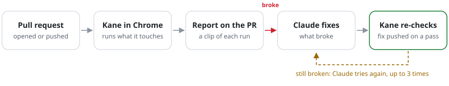

<div align="center">


# Proofed

**Every pull request, run in Chrome before you merge it.**

Kane CLI runs the user flows a pull request touches and posts the recording on the PR.<br>
When a flow breaks, Claude Code or OpenAI Codex fixes it, and the fix is pushed only after Kane has watched it pass.

[Website](https://proofed.neptunescodm.workers.dev) · [**Break it yourself**](https://proofed.neptunescodm.workers.dev/try) · [Dashboard demo](https://proofed.neptunescodm.workers.dev/app?demo) · [Install on GitHub](https://proofed.neptunescodm.workers.dev/install) · [CLI](#locally-and-from-an-ai-agent)

<sub>Built for the Kane CLI hackathon, November 2026.</sub>

<br>


</div>

<br>

<table>
<tr>
<th width="50%">✗ Kane catches the break</th>
<th width="50%">✓ Kane confirms Claude's fix</th>
</tr>
<tr>
<td></td>
<td></td>
</tr>
<tr>
<td>A €44.50 bag ships free, though free shipping starts at €50.</td>
<td>Claude changed one line in <code>src/pricing.ts</code>. Shipping is €4.90 again.</td>
</tr>
</table>

<p align="center"><sub>From <a href="https://github.com/t1dem/proofed-demo-store/pull/12">demo-store #12</a>: 8.5 minutes from opening the pull request to the fixed report.</sub></p>

## For judges

Four pull requests on the [demo store](https://github.com/t1dem/proofed-demo-store) each break one flow. All four have already run:

| PR | What Kane found | What happened next |
|---|---|---|
| [#5](https://github.com/t1dem/proofed-demo-store/pull/5) | The promo code `welcome10` in lowercase is rejected | Fixed on the first attempt ([`c242f6c`](https://github.com/t1dem/proofed-demo-store/commit/c242f6c)) |
| [#9](https://github.com/t1dem/proofed-demo-store/pull/9) | The confirmation page charges €13.00 instead of €17.90 | Kane rejected the first attempt, the second passed ([`f9fa5a6`](https://github.com/t1dem/proofed-demo-store/commit/f9fa5a6)) |
| [#11](https://github.com/t1dem/proofed-demo-store/pull/11) | The + button in the bag leaves the quantity at 1 | Fixed on the first attempt ([`9999a0d`](https://github.com/t1dem/proofed-demo-store/commit/9999a0d)), 8.5 minutes |
| [#12](https://github.com/t1dem/proofed-demo-store/pull/12) | A €44.50 bag ships free | Fixed on the first attempt ([`f54f1b5`](https://github.com/t1dem/proofed-demo-store/commit/f54f1b5)), 8.5 minutes |

To watch one run live, open [Break it yourself](https://proofed.neptunescodm.workers.dev/try). It needs no account and takes 8 to 14 minutes.


To run Proofed on your machine, with a signed-in [Kane CLI](https://www.npmjs.com/package/@testmuai/kane-cli), Node 22.18+, Chrome and ffmpeg:

```sh
git clone https://github.com/t1dem/proofed-demo-store
cd proofed-demo-store
npx proofed-cli check "the promo code welcome10 takes 10% off"
```

The [dashboard demo](https://proofed.neptunescodm.workers.dev/app?demo) needs no sign-in. Proofed also checks its own pull requests, for example [#25](https://github.com/t1dem/proofed/pull/25#issuecomment-6897255024).

### Bugs from real projects

Proofed replayed merged pull requests from open-source projects that shipped a bug. Each scenario failed on the buggy commit and passed, unchanged, on the commit that fixed it:

| Buggy PR | What broke | Fixed |
|---|---|---|
| [Excalidraw #11974](https://github.com/excalidraw/excalidraw/pull/11974) | The main menu stays open after a click on the canvas | [#12053](https://github.com/excalidraw/excalidraw/pull/12053), 12 days later |
| [frontend-mini-challenges #264](https://github.com/sadanandpai/frontend-mini-challenges/pull/264) | Delete leaves the todo item in the list | [#338](https://github.com/sadanandpai/frontend-mini-challenges/pull/338), 28 days later |
| [omni-tools #32](https://github.com/iib0011/omni-tools/pull/32) | The numbers 1, 2 and 4 on separate lines add up to 0 instead of 7 | [#428](https://github.com/iib0011/omni-tools/pull/428), 567 days later |

## How it works

<picture>
  <source media="(prefers-color-scheme: dark)" srcset="docs/flow-dark.svg">
  
</picture>

- Only the scenarios whose `paths` the diff touches run.
- A start page that crashes on load fails at once, with the browser's error and a screenshot, at no Kane credits.
- Kane doesn't record video, so Proofed records Chrome itself. The clip cuts the waiting, shows where Kane clicked and zooms in on what it checks.
- When Kane blames the test rather than the code, the scenario shows as "not checked", never as a pass.
- A fix starts when someone ticks **Fix with Claude** or **Fix with Codex**, or on its own with [Fix automatically](#fix-automatically) on.
- Nothing is pushed until Kane has seen the broken flows pass. Then every scenario the pull request touches runs on the fix commit.
- The fix commit's `Fixed-by:` line names the model.

## Scenarios

One Markdown file per flow in `.proofed/scenarios/`, in plain English. `paths` says which files it guards; without it, the scenario runs on every PR.

```md
---
name: Promo code total
paths: [src/pricing.ts, src/pages/Cart.tsx]
url: /
---
Add Ethiopia Guji to the bag twice and the Hand Grinder once.
Open the bag, type the promo code welcome10 in lowercase and apply it.
Check that the discount is −€9.10, shipping is Free and the total is €81.90.
```

## Commands

Comment on a PR. Only people with write access can run them.

| Comment | What happens |
|---|---|
| `/proofed` | Check the PR again |
| `/proofed <what to check>` | Kane checks just that, e.g. `/proofed the kettle goes into the bag at €45.00` |
| `/proofed fix` | Fix with the repository's selected provider and model |
| `/proofed fix opus high` | This one fix with Claude Opus at high effort |
| `/proofed fix sol high` | This one fix with Codex GPT-6.1 Sol at high effort |
| `/proofed fix codex` | This one fix with Codex GPT-6.1 Sol |

The repo's provider, model and effort are set in the [dashboard](https://proofed.neptunescodm.workers.dev/app), under Settings in the repo's model menu. The two icons switch between Claude and Codex. Without a choice, fixes use Claude Haiku 5.5 at xhigh effort. The same choice writes scenarios on the setup PR.

## Fix automatically

By default a fix waits for someone to tick **Fix with Claude** or **Fix with Codex**. With **Fix automatically** on, it starts as soon as Kane sees a scenario fail. It doesn't start:

- on draft pull requests,
- on pushes by bots, so the fixer's own commit doesn't start another fix,
- on a run Kane marked "not checked".

In the [dashboard](https://proofed.neptunescodm.workers.dev/app), open Settings, click the model menu in the repo's row (it reads like "Haiku 5.5 · xhigh") and turn on **Fix automatically** at the bottom. Or with the GitHub CLI:

```sh
gh variable set PROOFED_AUTOFIX --body true --repo owner/repo   # on
gh variable delete PROOFED_AUTOFIX --repo owner/repo            # off
```

## Locally and from an AI agent

`proofed check` runs the same check on your machine, against the change you haven't pushed yet: the scenarios its files touch, in Chrome, with Kane CLI. A coding agent can run it before it says a UI change is done.

It needs Node 22.18 or later, Chrome, [Kane CLI](https://www.npmjs.com/package/@testmuai/kane-cli) signed in (`kane-cli login`) and ffmpeg for the clips.

Install it with `npm install -g proofed-cli` (or `pnpm add -g`, `bun add -g`), or run it once with `npx proofed-cli`.

The command is `proofed`; `proofed doctor` says what else is missing. On a Node older than 22.18 it stops with an error that says so. The package is built JavaScript with no dependencies and no install scripts. From a clone, `npm link` runs the TypeScript source instead.

In the app's repo:

| Command | What it does |
|---|---|
| `proofed doctor` | Checks Node, Git, the scenarios, Kane CLI and its login, credits, Chrome, ffmpeg and the app, each with a fix |
| `proofed list` | Every scenario, whether the change touches it and whether its pass is cached |
| `proofed check` | Runs the scenarios the change touches; `proofed check "the cart total updates"` checks just that |

In a repo that already runs Proofed on its PRs, `proofed check` needs no flags. `--dry-run` shows what would run and the credit estimate, for free. How the check finds the app, the exit codes, the JSON output and a sample run are in [docs/cli.md](docs/cli.md).

For an agent, add this to the app's `AGENTS.md` or `CLAUDE.md`:

```md
## Checking UI changes

Use `proofed doctor --json` for setup and fixes. Use `proofed list --json` for affected
scenarios (`selected`), cache and `estimatedCredits`; neither command spends credits.
Use `proofed check --dry-run --json` to plan a specific `--only <id>` or text check.
Run `proofed check --json` to check affected flows, or `proofed check "<what>" --json`.
Allow at least 10 minutes. stdout is one JSON document; progress is on stderr.
Exit 0: passed or nothing ran. On `failed`, read `reason` and `diagnosis`, fix and run `rerun`.
`failedCheck: "scenario_doubted"` is Kane's opinion: review the scenario's expectations.
`not_checked` is not a pass. On `error`, retry `rerun` once. Exit 3: follow `error.fix`.
Checks spend Kane credits; planning does not. Use `--no-retry` when another attempt is forbidden.
```

## Setup

1. Sign in at [proofed.neptunescodm.workers.dev](https://proofed.neptunescodm.workers.dev/app) and save your TestMu keys and a Claude token or OpenAI API key.
2. Install the GitHub App on a repo. Proofed opens a PR with the workflow and puts the keys into the repo's secrets.
3. On that PR, the selected provider writes up to five scenarios for the app's main flows. Only the ones Kane saw pass are committed.

A scenario takes 1 to 4 minutes and about 30 Kane credits the first time. A fix attempt re-runs only the scenarios that broke.

<details>
<summary><b>Setting it up by hand</b></summary>

<br>

Add `LT_USERNAME` and `LT_ACCESS_KEY` (TestMu: Settings → Keys) and either `CLAUDE_CODE_OAUTH_TOKEN` (from `claude setup-token`) or `CODEX_API_KEY` (an OpenAI API key) to the repo secrets, then add one workflow. The whole file, working, is [proofed-demo-store's](https://github.com/t1dem/proofed-demo-store/blob/main/.github/workflows/proofed.yml); the part that matters:

```yaml
on:
  pull_request:
  issue_comment:
    types: [created, edited]
permissions: { contents: write, pull-requests: write, issues: write, statuses: write, id-token: write }
jobs:
  proofed:
    if: # PR events, /proofed comments from people with write access, and a ticked box (see the demo store)
    runs-on: ubuntu-latest
    concurrency:
      group: proofed-${{ github.event.pull_request.number || github.event.issue.number }}
      # A new push cancels a stale check, but not the push of the fix: that run waits for the fix run.
      cancel-in-progress: ${{ github.event_name == 'pull_request' && github.actor != 'proofed-by-kane[bot]' }}
    steps:
      - uses: t1dem/proofed@main
        with:
          url: http://localhost:4173
          install: npm ci
          build: npm run build
          serve: npm run preview
          lt-username: ${{ secrets.LT_USERNAME }}
          lt-access-key: ${{ secrets.LT_ACCESS_KEY }}
          claude-code-oauth-token: ${{ secrets.CLAUDE_CODE_OAUTH_TOKEN }}
          codex-api-key: ${{ secrets.CODEX_API_KEY }}
          vars: ${{ toJSON(vars) }}
```

- `vars` hands the action every Actions variable of the repo, so a new setting from the dashboard works without editing the workflow.
- `id-token: write` lets the fixer push the fix commit as the Proofed GitHub App, so your other workflows run on the fix commit without waiting for approval. Without it the fix is pushed with `GITHUB_TOKEN`.
- Clips go to a `proofed-clips` branch of the same repo, so the GIFs render in the comment with no storage of your own, in private repos too.
- Claude aliases: `haiku`, `sonnet`, `opus`, `fable`. A version such as `opus 5.1` and full Claude IDs are accepted. Effort: `low`, `medium`, `high`, `xhigh`, `max`.
- Codex aliases: `sol`, `terra`, `astra`, `luna`. Full IDs: `gpt-6.1-sol`, `gpt-6.1-terra`, `gpt-6-astra`, `gpt-6-luna`. Effort: `low`, `medium`, `high`, `xhigh`, `max`; Sol, Terra and Astra also accept `ultra`.
- Actions variables `PROOFED_PROVIDER`, `PROOFED_MODEL`, `PROOFED_EFFORT` and `PROOFED_AUTOFIX` store the menu choice. The provider can be inferred from the model. Existing Claude workflows and their checkbox label keep working. To enable Codex in an installed workflow, add `codex-api-key: ${{ secrets.CODEX_API_KEY }}` and let its edited-comment condition match `- [x] **Fix with Codex**` as well as `- [x] **Fix with Claude**`.
- Codex CLI 0.169.0 is installed only for Codex runs. `codex exec` reads `CODEX_API_KEY`; local runs can also use `codex login`. Its workspace-write sandbox blocks command network access and writes outside the workspace. Codex has no per-command tool allowlist: the prompt limits commands to reading the app and building it, and Proofed restores changes to scenarios and workflows before checking a fix.
- The checkout keeps no token in `.git/config` (`persist-credentials: false`); the push hands the token to git itself. Claude and Codex start without the job's tokens. A change that still contains one is discarded before it is built or checked, and the agent's answer is masked before it reaches the PR or the dashboard.

</details>

## Mobile and desktop apps

A scenario can set `target: ios`, `android` or `desktop`; scenarios without it stay web checks.

- **iOS and Android** need a built app, Kane's managed simulator or emulator dependencies and one device you booted yourself, picked by `device` and `os_version`. `proofed doctor --target ios` (or `android`) lists what is missing and installs nothing. The clip keeps portrait orientation. The credit estimate is unknown until the first run.
- **Desktop** is experimental and covers one Electron Chromium window: give `launch` and `cdp_endpoint`. Native menus, OS file dialogs, Safari, Tauri and WKWebView are not supported.
- **Tested so far:** desktop with VS Code on macOS. iOS and Android are covered only by tests with fake devices and have not run on a real simulator or emulator yet.
- Cloud mobile runs give Kane's screenshots, not a Proofed MP4. In the action, set `fix: false` for these targets: the fixer only restarts an HTTP server.

Requirements and commands: [docs/cli.md](docs/cli.md#mobile-and-electron-targets).

## Limits

- **Kane's verdict on the same failure varies.** On [#6](https://github.com/t1dem/proofed-demo-store/pull/6) the check that [#9](https://github.com/t1dem/proofed-demo-store/pull/9) reports as a break came back twice as "the test may be wrong". Without a failed check, Proofed shows such a run as not confirmed and starts no fix. A failed `assert:` that Kane blames on the scenario is run a second time, and stays a failure when it fails again.
- **Fixes need room in the selected provider's usage limit.** On [#7](https://github.com/t1dem/proofed-demo-store/pull/7) and [#8](https://github.com/t1dem/proofed-demo-store/pull/8) it ran out: Kane caught the break, no fix followed, and the report says so.
- **Only flows with a scenario are checked.** A scenario whose `paths` miss a file isn't picked when that file changes.
- **Slow next to unit tests.** One to four minutes of Kane per scenario, plus a build and a re-check per fix attempt.

## What we ran into with Kane CLI

What went wrong in real runs, and what Proofed does about it.

| What happened | What Proofed does | Where |
|---|---|---|
| Asked something vague, Kane waited and reported a pass | A pass with no `assert` step counts as "not checked" | `src/run.ts` |
| Kane routed around a broken button and passed | Kane is told to do each step once, with no other way to the goal | `src/run.ts` |
| A run was still going after 361 seconds | A 360-second wall-clock limit over Kane's own `--timeout 300` | `src/kane.ts` |
| Kane's children outlived a plain kill and held the output open | Kane runs in its own process group, killed as a whole | `src/kane.ts` |
| On a page that was fine, Kane reported a heading as not visible and blamed the scenario | A failed check Kane blames on the scenario is run a second time; the second run is the result | `src/run.ts` |
| In 13 of 36 parallel starts, a scenario exited within seconds | One `kane-cli login` before the scenarios, and one retry; the retry always reached a verdict | `action.yml`, `src/run.ts` |

## Code

Node 22.18+ runs the checkout's TypeScript directly, so the GitHub Action needs no build or package install. `pnpm build` emits the CLI and its imports to `dist/` for npm; `npm pack` builds it automatically. `pnpm typecheck` and `pnpm test` check the source. `pnpm check:package` builds a tarball, checks its contents, installs it into a temporary prefix and runs its version and help, then removes its temp files.

Releasing to npm is manual: [docs/release.md](docs/release.md).

| File | What it does |
|---|---|
| `src/cli.ts` | The PR check |
| `src/fix.ts` | The fix loop |
| `src/run.ts` | One scenario: Chrome, recorder, Kane, clip |
| `src/generate.ts` | The setup PR's first scenarios |
| `src/mode.ts` | Decides what an event asks for |
| `site/` | The dashboard, `/try` and the Cloudflare Worker behind them |

## License

[MIT](LICENSE)
