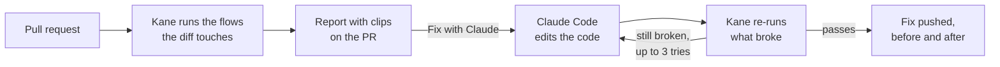
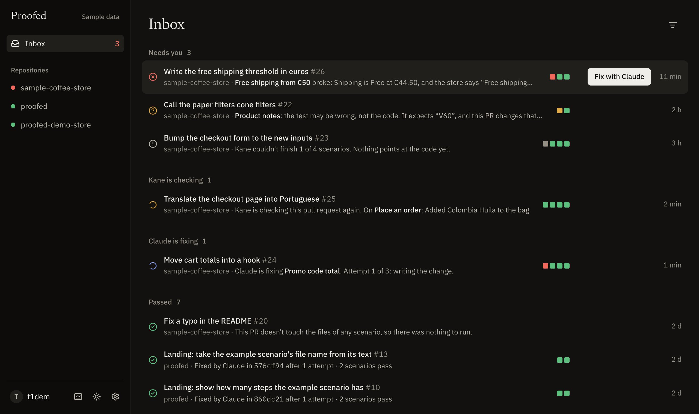

<div align="center">


# Proofed

**Every pull request, run in Chrome before you merge it.**

Proofed runs the user flows a pull request touches in real Chrome with [Kane CLI](https://github.com/LambdaTest/kane-cli), records each run and posts the clip on the PR.<br>
When a flow breaks, Claude Code fixes it. The fix is pushed only after Kane has watched it pass.

[**Break it yourself**](https://proofed.neptunescodm.workers.dev/try) · [Dashboard demo](https://proofed.neptunescodm.workers.dev/app?demo) · [Demo store](https://github.com/t1dem/proofed-demo-store) · [Install on GitHub](https://proofed.neptunescodm.workers.dev/install)

<sub>Built for the Kane CLI hackathon, November 2026.</sub>

</div>

<br>

<table>
<tr>
<th width="50%">✗ Kane catches the break</th>
<th width="50%">✓ Kane confirms Claude's fix</th>
</tr>
<tr>
<td></td>
<td></td>
</tr>
<tr>
<td>A €44.50 bag ships free, though free shipping starts at €50.</td>
<td>Claude changed one line in <code>src/pricing.ts</code>. Shipping is €4.90 again and turns Free at €51.00.</td>
</tr>
</table>

<p align="center"><sub>From <a href="https://github.com/t1dem/proofed-demo-store/pull/12">demo-store #12</a>: 8.5 minutes from opening the pull request to the fixed report.</sub></p>

## For judges

- **Try it, no account.** Open [/try](https://proofed.neptunescodm.workers.dev/try) and pick one of four prepared pull requests. Proofed opens it on [t1dem/proofed-demo-store](https://github.com/t1dem/proofed-demo-store), a real repository, and the page follows the run: Kane in Chrome, the report, Claude's fix, Kane's re-check. A run takes 8 to 14 minutes. One goes at a time, 15 a day, 3 per visitor, because each one spends Kane credits and Claude's time.
- **Read instead of waiting.** All four changes have already run on the demo store, see the table below.
- **The dashboard without signing in.** [/app?demo](https://proofed.neptunescodm.workers.dev/app?demo). The pull requests of `t1dem/proofed` and `t1dem/proofed-demo-store` in it are copied from GitHub. The `sample-coffee-store` repository is made up, to show every state at once, and is labelled "Sample data".
- **Proofed checks itself.** Every pull request to this repository runs five dashboard scenarios through Kane, for example [#25](https://github.com/t1dem/proofed/pull/25#issuecomment-6897255024).


#5 and #9 were opened from /try; #11 and #12 are the other two changes, opened by hand.

| Pull request | What Kane found | What happened next |
|---|---|---|
| [demo-store #5](https://github.com/t1dem/proofed-demo-store/pull/5) | The promo code `welcome10` typed in lowercase is rejected | Claude fixed it on the first attempt ([`c242f6c`](https://github.com/t1dem/proofed-demo-store/commit/c242f6c)), Kane confirmed |
| [demo-store #9](https://github.com/t1dem/proofed-demo-store/pull/9) | The confirmation page charges €13.00 instead of €17.90 | Kane didn't confirm Claude's first attempt; the second passed ([`f9fa5a6`](https://github.com/t1dem/proofed-demo-store/commit/f9fa5a6)) |
| [demo-store #11](https://github.com/t1dem/proofed-demo-store/pull/11) | The + button in the bag leaves the quantity at 1 | Claude fixed it on the first attempt ([`9999a0d`](https://github.com/t1dem/proofed-demo-store/commit/9999a0d)), Kane confirmed; 8.5 minutes in all |
| [demo-store #12](https://github.com/t1dem/proofed-demo-store/pull/12) | A €44.50 bag ships free, though free shipping starts at €50 | Claude fixed it on the first attempt ([`f54f1b5`](https://github.com/t1dem/proofed-demo-store/commit/f54f1b5)), Kane confirmed; 8.5 minutes in all |

## How a pull request goes



1. **Pick.** Proofed diffs the PR against the base branch and picks the scenarios whose `paths` the diff touches.
2. **Precheck.** Each start page is opened once in headless Chrome. A page that throws while loading and stays blank fails its scenarios right away, with the browser's error and a screenshot of what a user sees, without spending Kane credits.
3. **Run.** Each scenario runs in its own headless Chrome. Kane drives the browser; Proofed records the screen over the Chrome DevTools Protocol, since Kane doesn't record video. The clip keeps a moment around each of Kane's clicks and keystrokes and cuts the waiting between them. A cursor shows where Kane clicked, the camera zooms in on the element it's using, and the clip ends on the part of the page the final check was about.
4. **Report.** The PR gets a comment with a GIF of each run, a link to the mp4 and Kane's explanation of what went wrong. The commit gets a `Proofed` status. A push that finds the same as before updates that comment. A different outcome, a `/proofed` comment or the end of a fix posts a new one, so GitHub notifies you, and folds the old one as outdated.
5. **Not checked.** If Kane decides the test itself is wrong rather than the code, or reports a pass without checking anything on the page, the scenario is flagged as not checked: it doesn't block the merge, and it isn't counted as a pass. Browser hiccups (a screenshot timeout, a closed tab) are retried once and never reported as bugs.
6. **Fix.** Tick **Fix with Claude**, or comment `/proofed fix`. Claude Code edits the code, the app is rebuilt, and Kane re-runs the broken scenarios. Up to three attempts, each one told why the last failed. Nothing is pushed until a fix passes. The report and the commit (a `Fixed-by:` line) say which model made the fix, and the report shows each repaired scenario before and after: the failing run next to the passing one, and the files the fix changed.



<p align="center"><sub>The <a href="https://proofed.neptunescodm.workers.dev/app?demo">dashboard</a> groups pull requests by what they need from you.</sub></p>

## Scenarios

A scenario is a Markdown file in `.proofed/scenarios/`: frontmatter, then the objective Kane runs, in plain English.

```md
---
name: Promo code total
paths: [src/pricing.ts, src/pages/Cart.tsx]
url: /
---
Add Ethiopia Guji to the bag twice and the Hand Grinder once.
Open the bag, type the promo code welcome10 in lowercase and apply it.
Check that the discount is −€9.10, shipping is Free and the total is €81.90.
```

A scenario without `paths` runs on every PR. Editing a scenario file also runs it.

## Commands

Comment on a PR. Only people with write access to the repo can run them.

| Comment | What happens |
|---|---|
| `/proofed` | Check the PR again. Works on PRs opened before Proofed was added; scenarios then come from the base branch. |
| `/proofed <what to check>` | Kane checks just that, e.g. `/proofed the kettle goes into the bag at €45.00`. |
| `/proofed fix` | Same as ticking the box: Claude fixes it with the repo's model. |
| `/proofed fix opus high` | This one fix with another model. `haiku`, `sonnet`, `opus` and `fable` mean the latest version; `opus 5.1` picks a version; a full ID like `claude-opus-5-1` is used as written. Effort (`low`, `medium`, `high`, `xhigh`, `max`) goes last and is optional. |

The repo's model is set in the [Proofed dashboard](https://proofed.neptunescodm.workers.dev/app) and saved as the `PROOFED_MODEL` and `PROOFED_EFFORT` Actions variables. Without them it's Haiku 5.5 at xhigh effort.

## Setup

1. Sign in at [proofed.neptunescodm.workers.dev](https://proofed.neptunescodm.workers.dev/app) and save your keys.
2. Install the GitHub App on a repo. Proofed opens a PR with the workflow and a first scenario, and puts the keys into the repo's secrets.
3. That PR's check has Claude read the app and write up to five scenarios for its main flows. Kane runs each one, and only the ones it saw pass are committed to the PR. This happens only while `home.md` is the only scenario, and only with a Claude token.

<details>
<summary><b>Setting it up by hand</b></summary>

<br>

Add `LT_USERNAME` and `LT_ACCESS_KEY` (TestMu: Settings → Keys) and `CLAUDE_CODE_OAUTH_TOKEN` (from `claude setup-token`) to the repo secrets, then add one workflow. The action checks out the PR, builds and serves the app with your commands, and checks or fixes depending on the event. The whole file, working, is [proofed-demo-store's](https://github.com/t1dem/proofed-demo-store/blob/main/.github/workflows/proofed.yml); the part that matters:

```yaml
on:
  pull_request:
  issue_comment:
    types: [created, edited]
permissions: { contents: write, pull-requests: write, issues: write, statuses: write, id-token: write }
jobs:
  proofed:
    if: # PR events, /proofed comments from people with write access, and a ticked box (see the demo store)
    runs-on: ubuntu-latest
    concurrency:
      group: proofed-${{ github.event.pull_request.number || github.event.issue.number }}
      # A new push cancels a stale check, but not the push of Claude's fix: that run waits for the fix run.
      cancel-in-progress: ${{ github.event_name == 'pull_request' && github.actor != 'proofed-by-kane[bot]' }}
    steps:
      - uses: t1dem/proofed@main
        with:
          url: http://localhost:4173
          install: npm ci
          build: npm run build
          serve: npm run preview
          lt-username: ${{ secrets.LT_USERNAME }}
          lt-access-key: ${{ secrets.LT_ACCESS_KEY }}
          claude-code-oauth-token: ${{ secrets.CLAUDE_CODE_OAUTH_TOKEN }}
          vars: ${{ toJSON(vars) }}
```

- `vars` hands the action every Actions variable of the repo, so a new setting from the dashboard works without editing the workflow.
- `id-token: write` lets the fixer push Claude's commit as the Proofed GitHub App: Proofed's server checks the job's OIDC token and returns a token that can only push to that one repository. A push with the job's own `GITHUB_TOKEN` would leave every workflow on the fix commit, your CI included, waiting for someone to approve it. The app's push starts a normal check of the fix commit; it sees the report is already about that commit and finishes in seconds. Without `id-token: write` the fix is pushed with `GITHUB_TOKEN` as before.
- Repos set up before this keep working: without `serve`, the action only runs the check against an app the workflow already serves, and `t1dem/proofed/fix@main` stays the fixer.
- Clips are committed to a `proofed-clips` branch of the same repo, so the GIFs render inline in the comment without any storage of your own. This works in private repos too: anyone who can open the PR can see the clips.

</details>

## Cost

A scenario takes about a minute and 20–30 Kane credits. Proofed only runs the scenarios the diff touches, and a fix attempt re-runs only the ones that broke.

## What it doesn't do

- **Kane's verdict on the same failure varies.** On [demo-store #6](https://github.com/t1dem/proofed-demo-store/pull/6) the same failed check that #9 reports as a break came back twice as "the test may be wrong". Proofed shows such a run as not confirmed, never as a pass, and starts no fix. The scenario now says where its €17.90 comes from; #9 ran after that change.
- **The fixer needs Claude to be available.** Fixes on the demo store run on a subscription token. On [#7](https://github.com/t1dem/proofed-demo-store/pull/7) and [#8](https://github.com/t1dem/proofed-demo-store/pull/8) the usage limit was reached, so Kane caught the break and no fix followed. The report says so.
- **It checks only what a scenario describes.** A flow nobody wrote a scenario for isn't run, and a scenario whose `paths` miss a file isn't picked when that file changes.
- **It is slow next to unit tests.** A scenario takes one to four minutes of Kane's time, and a fix adds a build and a re-check per attempt.

## What running Kane in CI took

Each of these is a few lines in `src/`, found by a run that went wrong.

| What went wrong | What Proofed does | Where |
|---|---|---|
| Asked something vague, Kane opened the page, waited and reported a pass. | A pass with no `assert` step counts as "not checked". | `src/run.ts` |
| Left alone, Kane routes around a broken button and passes. | Kane is told to do each step once and not to reach the goal another way. | `src/run.ts` |
| One run was still going after 361 seconds. | A wall-clock limit of 360 seconds sits over Kane's own `--timeout 300`. | `src/kane.ts` |
| Kane's runner and Playwright children outlive a plain kill and hold the output open. | Kane runs in its own process group, killed as a whole. | `src/kane.ts` |
| In 13 of 36 runs that started scenarios side by side, one of the first exited within seconds. | `kane-cli login` runs once before the parallel scenarios, and a scenario that ends without a verdict is retried once. The retry always reached a verdict. | `action.yml`, `src/run.ts` |
| A start page that throws while loading wastes a whole Kane run. | It fails its scenarios before Kane runs, with the browser's error and a screenshot, at no credits. | `src/precheck.ts` |

## Code

TypeScript that Node 24 runs directly, no build step. `pnpm test` runs the unit tests.

| File | What it does |
|---|---|
| `src/mode.ts` | Decides what an event asks for |
| `src/cli.ts` | The PR check |
| `src/fix.ts` | The fix loop |
| `src/generate.ts` | The setup PR's first scenarios |
| `src/run.ts` | One scenario: Chrome, recorder, Kane, clip |
| `site/` | The dashboard, `/try` and the Cloudflare Worker behind them |
