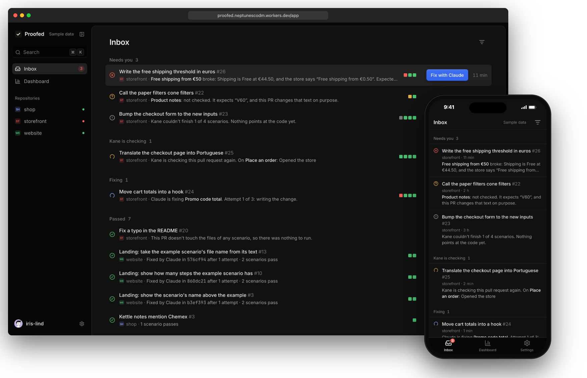

<div align="center">


# Proofed

**Every pull request, run in Chrome before you merge it.**

Kane CLI runs the user flows a pull request touches and posts the recording on the PR.<br>
When a flow breaks, Claude Code fixes it, and the fix is pushed only after Kane has watched it pass.

[**Break it yourself**](https://proofed.neptunescodm.workers.dev/try) · [Dashboard demo](https://proofed.neptunescodm.workers.dev/app?demo) · [Demo store](https://github.com/t1dem/proofed-demo-store) · [Install on GitHub](https://proofed.neptunescodm.workers.dev/install)

<sub>Built for the Kane CLI hackathon, November 2026.</sub>

<br>



</div>

<br>

<table>
<tr>
<th width="50%">✗ Kane catches the break</th>
<th width="50%">✓ Kane confirms Claude's fix</th>
</tr>
<tr>
<td></td>
<td></td>
</tr>
<tr>
<td>A €44.50 bag ships free, though free shipping starts at €50.</td>
<td>Claude changed one line in <code>src/pricing.ts</code>. Shipping is €4.90 again.</td>
</tr>
</table>

<p align="center"><sub>From <a href="https://github.com/t1dem/proofed-demo-store/pull/12">demo-store #12</a>: 8.5 minutes from opening the pull request to the fixed report.</sub></p>

## For judges

- **[Break it yourself](https://proofed.neptunescodm.workers.dev/try)**, no account. Pick one of four prepared pull requests and watch Kane catch the break and Claude fix it on the real [demo store](https://github.com/t1dem/proofed-demo-store). A run takes 8 to 14 minutes, one at a time, 3 per visitor a day.
- **[Dashboard demo](https://proofed.neptunescodm.workers.dev/app?demo)**, no sign-in. `sample-coffee-store` in it is made up and labelled "Sample data"; the rest is copied from GitHub.
- **Proofed checks itself.** Every pull request here runs five dashboard scenarios through Kane, for example [#25](https://github.com/t1dem/proofed/pull/25#issuecomment-6897255024).


If you'd rather read than wait, all four changes have already run:

| PR | What Kane found | What happened next |
|---|---|---|
| [#5](https://github.com/t1dem/proofed-demo-store/pull/5) | The promo code `welcome10` in lowercase is rejected | Fixed on the first attempt ([`c242f6c`](https://github.com/t1dem/proofed-demo-store/commit/c242f6c)) |
| [#9](https://github.com/t1dem/proofed-demo-store/pull/9) | The confirmation page charges €13.00 instead of €17.90 | Kane rejected the first attempt, the second passed ([`f9fa5a6`](https://github.com/t1dem/proofed-demo-store/commit/f9fa5a6)) |
| [#11](https://github.com/t1dem/proofed-demo-store/pull/11) | The + button in the bag leaves the quantity at 1 | Fixed on the first attempt ([`9999a0d`](https://github.com/t1dem/proofed-demo-store/commit/9999a0d)), 8.5 minutes |
| [#12](https://github.com/t1dem/proofed-demo-store/pull/12) | A €44.50 bag ships free | Fixed on the first attempt ([`f54f1b5`](https://github.com/t1dem/proofed-demo-store/commit/f54f1b5)), 8.5 minutes |

## How it works

<picture>
  <source media="(prefers-color-scheme: dark)" srcset="docs/flow-dark.svg">
  
</picture>

- Only the scenarios whose `paths` the diff touches run.
- A start page that crashes on load fails at once, with the browser's error and a screenshot, at no Kane credits.
- Kane doesn't record video, so Proofed records Chrome itself. The clip cuts the waiting, shows where Kane clicked and zooms in on what it checks.
- When Kane blames the test rather than the code, the scenario shows as "not checked", never as a pass.
- A fix starts when someone ticks **Fix with Claude**, or on its own with [Fix automatically](#fix-automatically) on.
- Nothing is pushed until Kane has seen a fix pass. The commit's `Fixed-by:` line names the model.

## Scenarios

One Markdown file per flow in `.proofed/scenarios/`, in plain English. `paths` says which files it guards; without it, the scenario runs on every PR.

```md
---
name: Promo code total
paths: [src/pricing.ts, src/pages/Cart.tsx]
url: /
---
Add Ethiopia Guji to the bag twice and the Hand Grinder once.
Open the bag, type the promo code welcome10 in lowercase and apply it.
Check that the discount is −€9.10, shipping is Free and the total is €81.90.
```

## Commands

Comment on a PR. Only people with write access can run them.

| Comment | What happens |
|---|---|
| `/proofed` | Check the PR again |
| `/proofed <what to check>` | Kane checks just that, e.g. `/proofed the kettle goes into the bag at €45.00` |
| `/proofed fix` | Same as ticking **Fix with Claude** |
| `/proofed fix opus high` | This one fix with another model and effort |

The repo's model is set in the [dashboard](https://proofed.neptunescodm.workers.dev/app). Without it, fixes use Haiku 5.5 at xhigh effort.

## Fix automatically

By default a fix waits for someone to tick **Fix with Claude**. With **Fix automatically** on, it starts as soon as Kane sees a scenario fail. Either way Claude gets up to three attempts, Kane re-runs the broken scenarios after each, and nothing is pushed until one passes. It doesn't start on drafts, on pushes by bots (Claude's own fix included) or on a run Kane marked "not checked".

Switch it in the dashboard (Settings, the model button in the repo's row) or with the GitHub CLI:

```sh
gh variable set PROOFED_AUTOFIX --body true --repo owner/repo   # on
gh variable delete PROOFED_AUTOFIX --repo owner/repo            # off
```

## Locally and from an AI agent

`proofed check` runs the same check on your machine, against the change you haven't pushed yet: the scenarios its files touch, in Chrome, with Kane CLI. A coding agent can run it before it says a UI change is done.

It needs Node 22.18 or later, Chrome, [Kane CLI](https://www.npmjs.com/package/@testmuai/kane-cli) signed in (`kane-cli login`) and ffmpeg for the clips.

Install the registry package with one manager:

| | npm | pnpm | bun |
|---|---|---|---|
| Install | `npm install -g proofed-cli` | `pnpm add -g proofed-cli` | `bun add -g proofed-cli` |
| Run without installing | `npx proofed-cli` | `pnpm dlx proofed-cli` | `bunx proofed-cli` |
| Update | `npm install -g proofed-cli@latest` | `pnpm add -g proofed-cli@latest` | `bun add -g proofed-cli@latest` |
| Uninstall | `npm uninstall -g proofed-cli` | `pnpm remove -g proofed-cli` | `bun remove -g proofed-cli` |

The command is `proofed`; `proofed doctor` says what else is missing. It runs on Node 22.18 or later with any of the three, bun included, and an older Node gets an error that says so. The package is built JavaScript with no dependencies and no install scripts. From a clone, `npm link` runs the TypeScript source instead.

In the app's repo:

| Command | What it does |
|---|---|
| `proofed doctor` | Checks Node, Git, the scenarios, Kane CLI and its login, credits, Chrome, ffmpeg and the app, each with a fix |
| `proofed list` | Every scenario, whether the change touches it and whether its pass is cached |
| `proofed check` | Runs the scenarios the change touches; `proofed check "the cart total updates"` checks just that |

The change is everything since the merge base with the default branch (`origin/HEAD`, else `origin/main`, or `--base`), uncommitted and untracked files included. The URL and the commands that install, build and serve the app come from `--url`, `--install`, `--build` and `--serve`, then `PROOFED_URL`, `PROOFED_INSTALL`, `PROOFED_BUILD` and `PROOFED_SERVE`, then `.proofed/config.json`, then the Proofed step of the repo's workflow. In a repo that already runs Proofed on its PRs, `proofed check` needs no flags. Before anything is built, the check asks TestMu, through `kane-cli balance` (free), whether it accepts the login or the `LT_USERNAME` and `LT_ACCESS_KEY` the runs would use; if not, it stops at once with exit 3: `kane_not_signed_in` with `kane-cli login` as the fix, or `kane_keys_rejected` when the keys are wrong or expired. If the app isn't running, Proofed starts it and stops it at the end: it installs the dependencies first when `node_modules` is missing or older than `package.json` or the lockfile (with the install command found as above, else the app's package manager), then builds, then serves. If something already answers at the URL and a build is configured, the check stops rather than test what may be an old build; `--reuse` tests it anyway.

A passed scenario isn't run again until its file, the URL, the base commit or a changed file in its `paths` changes. `--dry-run` shows what would run and the credit estimate, for free. In a terminal the scenarios update in place; in a pipe each event is one line, with a "still running" line at least every 30 seconds. From a real run on the demo store with the free shipping threshold changed to €60. Kane blamed the scenario, so the check ran twice, and the credits are for both runs. Paths are relative, and the credits in the "failed" line (56.8 in that run) are rounded as the CLI rounds them now:

```
Proofed: checking 1 of 3 scenario(s), --only, at http://localhost:4173.
Estimate: about 30 Kane credits.
Time: about 1 to 4 minutes per scenario, 3 at a time, so 1 to 4 minutes in all. Do not interrupt: let it finish.
Building the app: pnpm build
Starting the app: pnpm preview --port 4173
Started the app in 1 s (build from --build, serve from --serve); its output is in .proofed-out/serve.log
[0:01] started free-shipping: Free shipping from €50
[0:26] still running: free-shipping 0:25 at "Step 3"
[0:51] still running: free-shipping 0:50 at "Step 9"
[1:16] still running: free-shipping 1:15 at "assert: shipping is now Free and the total is €51.00."
[1:41] still running: free-shipping 1:40 at "assert: shipping is now Free and the total is €51.00."
[1:45] retrying free-shipping: the check failed, but Kane blames the scenario; running it once more to be sure
[2:11] still running: free-shipping 2:10 at "Step 3"
[2:36] still running: free-shipping 2:35 at "Step 8"
[3:01] still running: free-shipping 3:00 at "Step 10"
[3:26] still running: free-shipping 3:25 at "assert: shipping is now Free and the total is €51.00."
[3:51] failed free-shipping: Free shipping from €50 (3:50, 56.9 credits)

✗ Free shipping from €50 failed after 3:50
  Kane saw    Final verification failed: "shipping is now Free and the total is €51.00."
  Why         The scenario's check did not hold on the page, on two runs in a row. Kane believes the scenario is out of date.
  Kane thinks The test used the wrong free-shipping cutoff. After Paper Filters was increased, the basket subtotal was €51.00, which is still below the displayed €60.00 threshold, so the €4.90 shipping charge was correct.
  Next        If the change in the app was intended, update the scenario; otherwise fix the app.
  Failed step assert: shipping is now Free and the total is €51.00.
  Clip        .proofed-out/free-shipping/clip.mp4
  Scenario    .proofed/scenarios/free-shipping.md

✗ 1 failed · 56.9 credits · 3m 52s
Credits are Kane's report; balance may drop slightly more.
1 of 1 broke: Free shipping from €50
Re-run what broke: proofed check --only free-shipping --url http://localhost:4173 --serve 'pnpm preview --port 4173' --build 'pnpm build'
```

A first run is estimated at 30 Kane credits per scenario. Later estimates use the last reported cost. Credits are what Kane reported for the runs; the account balance can drop slightly more. An interrupted run can spend credits before Kane reports them.

`--json` prints one JSON document on stdout and the progress on stderr. Every run also writes it to `.proofed-out/result.json`, next to the clips; the folder has its own `.gitignore`. The exit code is 0 when everything checked passed, 1 when a scenario failed, 2 when nothing failed but something wasn't checked, 3 when the check couldn't start (the message says why and how to fix it; running it again unchanged won't help) and 130 on Ctrl-C or a closed terminal, which stops Kane, Chrome and the app first.

`failedCheck: "scenario_doubted"` means a scenario's check failed, but Kane believes it is out of date. `diagnosis` is Kane's opinion; `suggestion` and `next` say to update the scenario if the app change was intended, otherwise fix the app. Such a failure is run a second time before it is reported, at the scenario's cost again, and the second run is the result: Kane gives the same verdict when it misreads a page that is fine, and a misreading rarely repeats. A check that fails both times is a failure (exit 1). `notChecked: "scenario_doubted"` is used when Kane doubted the scenario without a failed check (exit 2).

For an agent, add this to the app's `AGENTS.md` or `CLAUDE.md`:

```md
## Checking UI changes

After changing UI code, run `proofed check --json` with a timeout of at least 10 minutes, and
don't interrupt it. stdout is one JSON document. Exit 0: everything checked passed.
- `failed`: read `reason` and `diagnosis`, fix the cause, run `rerun`.
  With `failedCheck: "scenario_doubted"`, diagnosis is Kane's opinion. If the app change was
  intended, update the scenario; otherwise fix the app.
- `not_checked` is not a pass: fix the scenario or tell the user why Kane doubts it.
- `error`: run its `rerun` command once more. Exit 3: do what `error.fix` says.
Each run costs Kane credits; `proofed check --dry-run --json` shows what would run, for free.
To check one thing without a scenario: `proofed check "the cart total updates" --json`.
```

## Setup

1. Sign in at [proofed.neptunescodm.workers.dev](https://proofed.neptunescodm.workers.dev/app) and save your TestMu and Claude keys.
2. Install the GitHub App on a repo. Proofed opens a PR with the workflow and puts the keys into the repo's secrets.
3. On that PR, Claude writes up to five scenarios for the app's main flows. Only the ones Kane saw pass are committed.

A scenario takes 1 to 4 minutes. The first-run estimate is 30 Kane credits. A fix attempt re-runs only the scenarios that broke.

<details>
<summary><b>Setting it up by hand</b></summary>

<br>

Add `LT_USERNAME` and `LT_ACCESS_KEY` (TestMu: Settings → Keys) and `CLAUDE_CODE_OAUTH_TOKEN` (from `claude setup-token`) to the repo secrets, then add one workflow. The whole file, working, is [proofed-demo-store's](https://github.com/t1dem/proofed-demo-store/blob/main/.github/workflows/proofed.yml); the part that matters:

```yaml
on:
  pull_request:
  issue_comment:
    types: [created, edited]
permissions: { contents: write, pull-requests: write, issues: write, statuses: write, id-token: write }
jobs:
  proofed:
    if: # PR events, /proofed comments from people with write access, and a ticked box (see the demo store)
    runs-on: ubuntu-latest
    concurrency:
      group: proofed-${{ github.event.pull_request.number || github.event.issue.number }}
      # A new push cancels a stale check, but not the push of Claude's fix: that run waits for the fix run.
      cancel-in-progress: ${{ github.event_name == 'pull_request' && github.actor != 'proofed-by-kane[bot]' }}
    steps:
      - uses: t1dem/proofed@main
        with:
          url: http://localhost:4173
          install: npm ci
          build: npm run build
          serve: npm run preview
          lt-username: ${{ secrets.LT_USERNAME }}
          lt-access-key: ${{ secrets.LT_ACCESS_KEY }}
          claude-code-oauth-token: ${{ secrets.CLAUDE_CODE_OAUTH_TOKEN }}
          vars: ${{ toJSON(vars) }}
```

- `vars` hands the action every Actions variable of the repo, so a new setting from the dashboard works without editing the workflow.
- `id-token: write` lets the fixer push Claude's commit as the Proofed GitHub App, so your other workflows run on the fix commit without waiting for approval. Without it the fix is pushed with `GITHUB_TOKEN`.
- Clips go to a `proofed-clips` branch of the same repo, so the GIFs render in the comment with no storage of your own, in private repos too.
- In `/proofed fix <model> <effort>`, `haiku`, `sonnet`, `opus` and `fable` mean the latest version, `opus 5.1` picks a version, and a full ID like `claude-opus-5-1` is used as written. Effort is `low`, `medium`, `high`, `xhigh` or `max`.

</details>

## Limits

- **Kane's verdict on the same failure varies.** On [#6](https://github.com/t1dem/proofed-demo-store/pull/6) the check that [#9](https://github.com/t1dem/proofed-demo-store/pull/9) reports as a break came back twice as "the test may be wrong". Without a failed check, Proofed shows such a run as not confirmed and starts no fix. A failed `assert:` that Kane blames on the scenario is run a second time, and stays a failure when it fails again.
- **Fixes need Claude's usage limit to have room.** On [#7](https://github.com/t1dem/proofed-demo-store/pull/7) and [#8](https://github.com/t1dem/proofed-demo-store/pull/8) it ran out: Kane caught the break, no fix followed, and the report says so.
- **Only flows with a scenario are checked.** A scenario whose `paths` miss a file isn't picked when that file changes.
- **Slow next to unit tests.** One to four minutes of Kane per scenario, plus a build and a re-check per fix attempt.

## What running Kane in CI took

Each fix is a few lines, found by a run that went wrong.

| What went wrong | What Proofed does | Where |
|---|---|---|
| Asked something vague, Kane waited and reported a pass | A pass with no `assert` step counts as "not checked" | `src/run.ts` |
| Kane routed around a broken button and passed | Kane is told to do each step once, with no other way to the goal | `src/run.ts` |
| A run was still going after 361 seconds | A 360-second wall-clock limit over Kane's own `--timeout 300` | `src/kane.ts` |
| Kane's children outlived a plain kill and held the output open | Kane runs in its own process group, killed as a whole | `src/kane.ts` |
| On a page that was fine, Kane reported a heading as not visible and blamed the scenario | A failed check Kane blames on the scenario is run a second time; the second run is the result | `src/run.ts` |
| In 13 of 36 parallel starts, a scenario exited within seconds | One `kane-cli login` before the scenarios, and one retry; the retry always reached a verdict | `action.yml`, `src/run.ts` |

## Code

Node 22.18+ runs the checkout's TypeScript directly. The GitHub Action needs no build or package install.
`pnpm build` emits the CLI and its imports to `dist/` for npm. `npm pack` builds it automatically.
`pnpm typecheck` and `pnpm test` check the source. `pnpm check:package` builds a tarball, checks its
contents, installs it into a temporary prefix and runs its version and help. It removes its temp files.

To release, confirm the version in `package.json` (currently `0.1.3`); published versions cannot be reused. From a clean checkout with Node 22.18+:

```sh
pnpm install --frozen-lockfile
npm login --registry=https://registry.npmjs.org/
npm whoami --registry=https://registry.npmjs.org/
npm publish --access public --registry=https://registry.npmjs.org/
npm view proofed-cli@0.1.3 version bin engines dist.tarball --registry=https://registry.npmjs.org/
npx --yes proofed-cli@0.1.3 --version
npx --yes proofed-cli@0.1.3 --help
```

Use the chosen version in the last three commands. `npm publish` runs typecheck, tests and the package
check before packing a fresh build. Complete npm's sign-in and two-factor prompts when asked.
Publishing is manual; no release workflow runs on pushes or pull requests.

| File | What it does |
|---|---|
| `src/cli.ts` | The PR check |
| `src/fix.ts` | The fix loop |
| `src/run.ts` | One scenario: Chrome, recorder, Kane, clip |
| `src/generate.ts` | The setup PR's first scenarios |
| `src/mode.ts` | Decides what an event asks for |
| `site/` | The dashboard, `/try` and the Cloudflare Worker behind them |

## License

[MIT](LICENSE)
